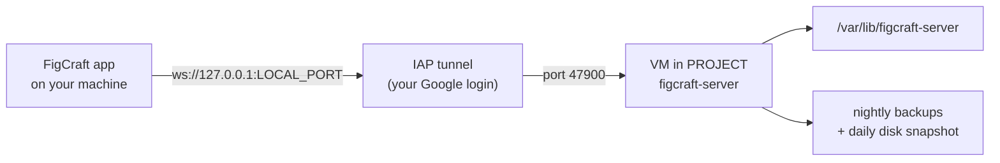

# figcraft-gcp

Run your own private [FigCraft](https://github.com/storytold/figcraft) collaboration server on
Google Cloud: setup scripts, a one-click launcher, and a runbook. One checkout runs any number of
servers, which are called deployments.

This is an independent project. It installs FigCraft's official `figcraft-server` release; it is
not part of FigCraft.

- **Private by design:** the VM has no public address. People reach it only through IAP TCP
  forwarding, which checks their Google account.
- **One deployment per group of people:** everyone who can reach a server sees and edits every file
  on its team list. Give a group with other people its own deployment.
- **Version:** the server must run the same version as the desktop app. Upgrade them together.



## Before you start

**To set up a server** you need:

- a Google Cloud project with billing turned on, and an auto-mode VPC network (`default`, unless
  you set `NETWORK`)
- the [Google Cloud CLI](https://cloud.google.com/sdk/docs/install) (`gcloud`), signed in with
  `gcloud auth login` as someone who can create VMs, firewall rules, IAM bindings and secrets in
  that project
- bash and the usual Unix tools: Linux or macOS

**To use a server** everyone needs:

- the [FigCraft](https://github.com/storytold/figcraft) desktop app, the same version as the
  server
- `gcloud`, signed in with a Google account that is in the deployment's `MEMBERS`
- an IAP tunnel to the server (see [Connect](#connect)). `bin/figcraft-connect` opens one, and
  needs Linux and Node.js 20 or newer
- for `bin/team-list` only: `jq`, and `figcraft-cli` from the FigCraft app

## Quickstart

From an empty Google Cloud project to a shared file:

1. **Describe the server.** Copy `deployments/example.env` to `deployments/<name>.env` and fill in
   your project, region, zone and the Google accounts of the people who get in.
2. **Check what would happen:** `bin/setup --dry-run`. It prints every `gcloud` command and runs
   none.
3. **Set it up:** `bin/setup`. It creates the VM with no public address, the firewall rule for
   IAP, Cloud NAT, the daily disk snapshot and the tunnel permissions. Then it installs the
   FigCraft server (checksum verified) and stores the server key in Secret Manager. This takes a
   few minutes.
4. **Connect:** run `bin/figcraft-connect`, or switch on the tunnel another way (see
   [Connect](#connect)), and start FigCraft.
5. **Publish a file:** in FigCraft, choose **File ▸ Publish to server…** and enter the
   `ws://…?key=…` line from the secret. Read it in your own terminal (it's a password):
   `gcloud secrets versions access latest --secret=<SECRET> --project=<PROJECT>`.
6. **Share it with everyone in the deployment:** `bin/team-list <file id>`. They find it under
   **Home ▸ Online ▸ Shared by your team**.

## Deployments

Each deployment is one settings file: the GCP project, region, VM, the people who get in, the
FigCraft version and the local tunnel port. `deployments/example.env` shows every setting.

- **Keep your deployments out of the repository.** Put them in `deployments/<name>.env` (git
  ignores everything there except the example), or in any folder of your own and point
  `FIGCRAFT_DEPLOYMENTS` at it.
- **Every script takes `--deployment NAME`.** With only one deployment, it's used without asking.

**Add a deployment:**

1. Copy `deployments/example.env` to `deployments/<name>.env`.
2. Fill in the project, region, zone, VM name, people, secret name and a local port no other
   deployment uses.
3. Check what would happen: `bin/setup --deployment <name> --dry-run`.
4. Set it up: `bin/setup --deployment <name>`.

**Prefer one GCP project per deployment.** The tunnel permission is granted on the whole project
(limited to FigCraft's port), so members of one deployment could also reach another deployment's VM
in the same project. When the same people use several deployments, they can share a project: give
each its own `RESOURCE_PREFIX`, which names the router, Cloud NAT, firewall rule, network tag and
snapshot schedule. `NETWORK` picks an auto-mode VPC network other than `default`.

## What's where

| Piece                   | Where                                                                                                                                                |
| ----------------------- | ---------------------------------------------------------------------------------------------------------------------------------------------------- |
| Settings per deployment | `deployments/<name>.env`, read by `lib/deployment.sh`                                                                                                |
| Setup (idempotent)      | `bin/setup` (`--dry-run` prints what it would do)                                                                                                    |
| On-VM install / upgrade | `server/provision.sh`, run by `bin/setup`                                                                                                            |
| Server settings         | `server/server.toml` → `/etc/figcraft-server/server.toml` (`bin/setup` fills in the local port)                                                      |
| systemd                 | the release's `figcraft-server.service` plus our drop-in `server/iap.conf` (admits IAP's range `35.235.240.0/20`)                                    |
| Data                    | `/var/lib/figcraft-server` (snapshot.bin + log.bin per file, not .figcraft)                                                                          |
| Server key              | Secret Manager, the deployment's `SECRET`: the whole output of `figcraft-server key` (a heading, then the `ws://…?key=…` address). Never in the repo |
| Backups                 | nightly `figcraft-backup.timer` → `/var/backups/figcraft-server` (7 days), plus the daily disk snapshot `figcraft-daily` (7 days)                    |
| Connect                 | `bin/figcraft-connect`; `bin/install-launcher` puts it in the app menu                                                                               |
| Team list               | `bin/team-list FILE_ID [unshare]` (see [Put a file on the team list](#put-a-file-on-the-team-list))                                                  |
| Cost                    | about $15 a month per deployment (e2-small, Cloud NAT, snapshots)                                                                                    |
| Tests                   | `npm test`                                                                                                                                           |

The commands below use the deployment's settings. Load them into your shell first:

```bash
source deployments/<name>.env
```

## Connect

**The IAP tunnel is required.** The VM has no public address, so every person reaches the server
through their own IAP tunnel from `localhost:$LOCAL_PORT` to port 47900 on the VM. There are three
ways to run it; pick one:

| Way                                                                     | Good for                                                          |
| ----------------------------------------------------------------------- | ----------------------------------------------------------------- |
| `bin/figcraft-connect` (below)                                          | Any Linux desktop. Opens the tunnel when FigCraft starts.         |
| [IAP Tunnels for GNOME](https://github.com/alexheidl/gnome-iap-tunnels) | GNOME. A switch in Quick Settings, like a VPN, and it reconnects. |
| A systemd user service ([below](#keep-the-tunnel-as-a-switch-linux))    | Linux without GNOME. Starts at login and comes back by itself.    |

Run `bin/figcraft-connect`. It signs you into Google if needed, opens the tunnel to
`localhost:$LOCAL_PORT`, and starts FigCraft with Claude's control port. Run
`bin/install-launcher` once to make the FigCraft entry in your app menu do the same.

Share links name `ws://127.0.0.1:$LOCAL_PORT/`, so they work for anyone whose tunnel is up.

**Everyone in a deployment must use the same local port.** The server writes `LOCAL_PORT` into
every link it hands out, so a person whose tunnel arrives on another port can't open those links.
Keep the port in the deployment's file and don't change it per person.

**Open files from Home ▸ Online ▸ "Shared by your team"** (the team list, `team_files = "edit"` in
`server.toml`). Everyone whose tunnel is up sees the shared files there and opens them with edit
access; nobody needs a share link. A file's team link
(`figcraft://join?server=ws://127.0.0.1:$LOCAL_PORT/&file=<id>&team=1`) carries no secret and can go
into an issue or a chat.

### Keep the tunnel as a switch (Linux)

**On GNOME, use [IAP Tunnels for GNOME](https://github.com/alexheidl/gnome-iap-tunnels).** It runs the tunnel in the background as a
systemd user service, shows it in Quick Settings and the top bar, and tells you when your Google
sign-in has expired. Add a tunnel in its settings window with the deployment's values:

| Field          | Value from the deployment |
| -------------- | ------------------------- |
| Project        | `PROJECT`                 |
| Zone           | `ZONE`                    |
| VM name        | `VM`                      |
| Port on the VM | `47900`                   |
| Local port     | `LOCAL_PORT`              |

Then switch it on in Quick Settings; it's ready when its row says _Connected_. The extension keeps
each tunnel in `~/.config/iap-tunnels/<id>.env` (`PROJECT`, `ZONE`, `INSTANCE`, `REMOTE_PORT`,
`LOCAL_PORT`) if you'd rather write the file yourself.

**Without GNOME,** run the tunnel as a systemd user service by hand. It doesn't need a terminal,
comes back by itself when the connection drops, and starts at login. Put this in
`~/.config/systemd/user/figcraft-tunnel.service` (with the deployment's values filled in):

```ini
[Unit]
Description=IAP tunnel to the FigCraft server
After=network-online.target

[Service]
ExecStart=/usr/bin/gcloud compute start-iap-tunnel figcraft 47900 --local-host-port=localhost:47900 --zone=europe-west3-a --project=my-figcraft-project
Restart=on-failure
RestartSec=5

[Install]
WantedBy=default.target
```

Then switch it with:

```bash
systemctl --user daemon-reload                  # once, after creating or editing the file
systemctl --user enable --now figcraft-tunnel   # on, and at every login
systemctl --user stop figcraft-tunnel           # off until you start it again
systemctl --user status figcraft-tunnel         # is it up?
journalctl --user -u figcraft-tunnel -n 20      # why it failed
```

- **It uses your own `gcloud` sign-in.** When that expires the service keeps failing. Run
  `gcloud auth login`, then restart the service.
- **`figcraft-connect` works alongside either one.** It sees the healthy tunnel and only starts
  FigCraft.
- **Restarting the tunnel drops every open FigCraft session.** Tabs reconnect, but edits that
  hadn't reached the server are lost. Don't restart it while someone is working.

**Never use "Leave session"** to close a file: it turns the tab into a disconnected copy, and Share
on that copy publishes it as a new file. Close the tab instead; the file stays on the server.

To publish a file you need the key:

```bash
gcloud secrets versions access latest "--secret=$SECRET" "--project=$PROJECT"
```

## Add or remove a person

IAP tunnel access can't be granted on one VM, so it's bound at project level, limited by a
condition to the FigCraft port (the same binding `bin/setup` makes):

```bash
gcloud projects add-iam-policy-binding "$PROJECT" \
  --member=user:NAME@example.com --role=roles/iap.tunnelResourceAccessor \
  "--condition=expression=destination.port == 47900,title=figcraft-tunnel-only"

# remove:
gcloud projects remove-iam-policy-binding "$PROJECT" \
  --member=user:NAME@example.com --role=roles/iap.tunnelResourceAccessor \
  "--condition=expression=destination.port == 47900,title=figcraft-tunnel-only"
```

- **Never bind the role without the condition.** That would open tunnels to every port and VM in
  the project.
- **This binding is also who is on the team list.** Whoever reaches the server sees and edits every
  listed file.
- **Also add them to `MEMBERS`** in the deployment's file, so `bin/figcraft-connect` lets them in
  and the next `bin/setup` keeps the binding.
- **For more than a few people,** bind a Workspace group (`group:…`) instead.
- **Never** use `domain:`, `allUsers` or `allAuthenticatedUsers`.

## Files and links

Files published with the key belong to the server, not to anyone's app: the app shows their links
only in the tab that published them, and lists them only on the team list. Manage them on the VM:

```bash
gcloud compute ssh "$VM" "--zone=$ZONE" --tunnel-through-iap "--project=$PROJECT" \
  --command 'sudo -u figcraft figcraft-server files list --config /etc/figcraft-server/server.toml'
```

The same way: `links list FILE`, `links create FILE --access edit|comment|view --label TEXT`,
`links revoke FILE LINK` (anyone joined with it is disconnected), `files remove FILE` (for good).

### Put a file on the team list

A newly published file is **not** on the team list: its team link fails with "this file isn't
shared now", and nobody else sees it under Shared by your team. Nothing in the app's Share panel
changes that: the panel only shows the publishing tab's own edit and view links.

With the FigCraft app open and the tunnel up, run:

```bash
bin/team-list FILE_ID            # put it on the list
bin/team-list FILE_ID unshare    # take it off again
```

- **It prints only** `shared: true` (or `false`) or an error.
- **The key never shows.** The script reads it from Secret Manager into a private temporary file,
  which is deleted afterwards.
- **It goes through the running app**, using `figcraft-cli mcp --attach`. Headless
  `figcraft-cli run` can't reach a server.
- **How it works:** the script calls `collab.manageFile` with `owner: "operator"` and the key in
  the server address. With the key there, the app acts as the server's operator.

## File size and memory

- **The server caps each file at 64 MiB** (`max_file_mb`, unset in `server.toml`). Over the cap it
  logs "over the 64 MiB cap (kept anyway)", and live sessions on that file start failing: edits are
  lost and tabs fall back to the server's copy.
- **The server needs about 30 times a file's size in memory** while someone has it open: 860 MB for
  a 25.8 MiB file. An e2-small has 2 GB and no swap. When a file passes about 40 MiB, add swap or
  move to a bigger machine (`MACHINE_TYPE`) before raising the cap.
- **Large uploads can stall the IAP tunnel,** and a stalled upload can hang the server. Check the
  size with `files list` before publishing a big file.

## Upgrade

1. Set `FIGCRAFT_VERSION` in the deployment's file to the new version.
2. Run `bin/setup --deployment NAME`. It re-runs `server/provision.sh`, which verifies the checksum
   and restarts the server; apps reconnect on their own.
3. Upgrade the desktop apps to the same version.

## Restore from a backup

```bash
gcloud compute ssh "$VM" "--zone=$ZONE" --tunnel-through-iap "--project=$PROJECT"
sudo systemctl stop figcraft-server
sudo tar -C /var/lib -xzf /var/backups/figcraft-server/figcraft-YYYY-MM-DD.tar.gz
sudo systemctl start figcraft-server
```

If the VM itself is lost, create a disk from the latest `figcraft-daily` snapshot.

## Rotate the server key

```bash
gcloud compute ssh "$VM" "--zone=$ZONE" --tunnel-through-iap "--project=$PROJECT" \
  --command 'sudo -u figcraft figcraft-server key --rotate --config /etc/figcraft-server/server.toml' 2>/dev/null |
  gcloud secrets versions add "$SECRET" --data-file=- "--project=$PROJECT"
```

## Health

```bash
curl -s "http://127.0.0.1:$LOCAL_PORT/healthz"   # with the tunnel up: "ok"
gcloud compute ssh "$VM" "--zone=$ZONE" --tunnel-through-iap "--project=$PROJECT" \
  --command 'journalctl -u figcraft-server -n 50'
```

## Contributing and security

- **Contributing:** see [CONTRIBUTING.md](CONTRIBUTING.md). Run `npm test` before a pull request.
- **Security problems:** report them privately, as [SECURITY.md](SECURITY.md) describes. It also
  explains what this setup protects and what it doesn't.
- **Changes:** [CHANGELOG.md](CHANGELOG.md).

## Licence

Licensed under either of

- Apache License, Version 2.0 ([LICENSE-APACHE](LICENSE-APACHE))
- MIT license ([LICENSE-MIT](LICENSE-MIT))

at your option, the same as FigCraft itself.

Unless you explicitly state otherwise, any contribution you intentionally submit for inclusion in
this project, as defined in the Apache-2.0 licence, is dual licensed as above, without any
additional terms or conditions.

FigCraft is developed by the ArtCraft Team. The ArtCraft name and logos are their trademarks; this
project doesn't use them.
